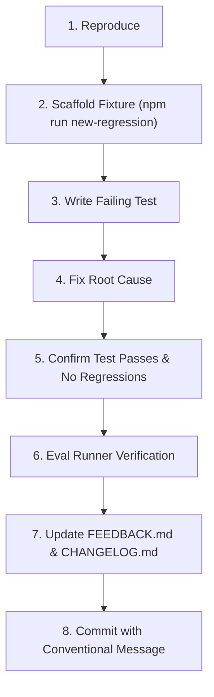

# StackDoctor Bug & Regression Fix Workflow

This document defines the strict, reproducible 8-step lifecycle for resolving every confirmed bug, false positive, or diagnostic inaccuracy reported in [FEEDBACK.md](../FEEDBACK.md).

> **Core Principle**: Never fix a bug without a regression test and a minimal synthetic fixture. Every fix must prove that the failure is resolved and that healthy code remains unaffected.

---

## The 8-Step Fix Loop



---

### Step 1: Reproduce Locally
- Read the issue description and associated entry in `FEEDBACK.md` (e.g. `FB-002`).
- Reproduce the exact error condition locally.
- Confirm whether the issue is:
  - A **false positive** (rule triggers when environment is healthy).
  - A **missed issue** (rule failed to trigger on a genuine breakage).
  - A **crash / tool error** (unexpected exception thrown).
  - An **inaccurate cause / remediation** (evidence or remediation was misleading).

---

### Step 2: Scaffold Synthetic Regression Fixture
StackDoctor provides an automated regression scaffolder:

```bash
npm run new-regression -- --id FB-002 --slug runtime-declaration-conflict
```

This generates:
- `examples/regressions/FB-002-runtime-declaration-conflict/` containing:
  - `README.md`: Explaining the reproduction scenario.
  - `expected.json`: Array of expected rule IDs (e.g. `[]` for false positives, or `["RULE_ID"]` for breakages).
- `packages/rules/test/regressions/FB-002-runtime-declaration-conflict.test.ts`: Vitest test stub.

> **Privacy Warning**: Never copy a user's actual proprietary files or real secrets into the fixture. Always recreate a synthetic, minimal dummy project using dummy package names and dummy variables.

---

### Step 3: Write a Failing Test First (TDD)
Open `packages/rules/test/regressions/<id>-<slug>.test.ts`. Implement the assertion that replicates the bug:

```typescript
import { describe, it, expect } from "vitest";
import { runCli } from "../../../../apps/cli/dist/index.js";
import path from "node:path";

describe("Regression FB-002: Runtime Declaration Conflict", () => {
  it("should not flag conflict when active Node version satisfies package.json engines", async () => {
    // Assert current failing behavior
  });
});
```
Run `npm test` and verify that the test fails as expected.

---

### Step 4: Fix the Root Cause
- Modify the rule in `packages/rules/src/rules/` or adapter in `packages/adapters/`.
- **Do not apply cosmetic workarounds**: Address the fundamental logic flaw in fact extraction, version range parsing, socket probing, or preconditions.
- Maintain the strict separation between `OBSERVED` (factual measurements) and `POSSIBLE` (hypotheses).

---

### Step 5: Verify Fix and Guard Against Collateral Damage
Run the complete verification chain to confirm:
1. The new regression test passes.
2. All existing 59 test suites pass (`npm test`).
3. No other fixtures were inadvertently broken.

---

### Step 6: Verify in Evaluation Harness
Run the accuracy benchmark:
```bash
npm run eval
```
The eval runner automatically discovers all fixtures under `examples/regressions/` and includes them in the global accuracy metrics:
- False positive fixtures (expected: `[]`) must produce 0 findings (0% false positives).
- Broken fixtures must detect 100% of declared expected rule IDs.

---

### Step 7: Update Living Logs
1. In `FEEDBACK.md`:
   - Change `Status` from `triaged` to `fixed`.
   - Update `Fixed in Version` (e.g. `0.1.1`).
2. In `CHANGELOG.md`:
   - Under `[Unreleased]` or `[0.1.x]`, add a bullet point citing the Feedback ID and PR number:
     - `Fixed false positive in RUNTIME_DECLARATIONS_CONFLICT when active version satisfies requirement (FB-002, #18).`

---

### Step 8: Commit with Conventional Format
Commit referencing the feedback identifier:
```bash
git commit -m "fix(rules): resolve false positive in runtime declaration check (FB-002)"
```
